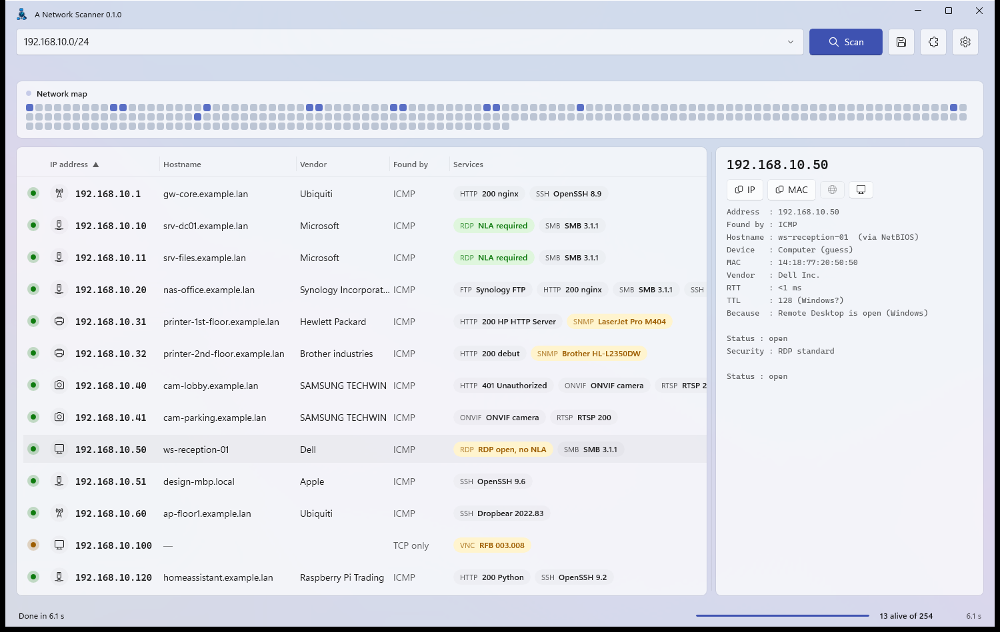

# A Network Scanner

A fast, native Windows network scanner. WinUI 3 and C# on .NET 10, unpackaged, **no administrator rights needed**, IPv4.



*Screenshot with fictional hosts and addresses.*

## Features

- **Discovery:** ICMP echo for every target. ARP is used only for addresses on your own subnets (it can find hosts that block ping); routed networks are never trusted to the ARP cache.
- **Silent hosts (optional):** a "force scan" tries common TCP ports on hosts that answer neither ping nor ARP. An open or refused port proves the host exists; it is listed as *TCP only*.
- **Service probes:** JSON-only plugins check ports and read banners (SSH, HTTP, RDP, SMB, SNMP, FTP, VNC, RTSP, mail, ONVIF, SIP, Ubiquiti, Unify/Mitel phones). All results of a host are merged into one Services column of coloured pills (SSH, HTTP, RDP and so on), and shown in full in the details panel.
- **Device guess:** computer, server, printer, camera, IP phone, network device or mobile, from banners, hostname, vendor, services and TTL.
- **MAC vendors:** a bundled IEEE OUI list; the app offers to update it when it is older than two months.
- **Hostnames (optional):** reverse DNS, mDNS and NetBIOS.
- **Polite by default:** a shared rate limiter covers every packet; speed, retries and timeouts are editable in Options.
- **Interface:** animated results table with resizable and hideable columns, network map, details panel with a resizable divider, light/dark theme, recent targets, export.

## Targets

```
192.168.1.0/24        10.0.0.1-50        172.16.*.*
192.168.1.5, 192.168.1.20-30            (comma-separated lists)
```

## Run

Download the zip from the releases, extract the whole folder and start `ANetworkScanner.exe`. Windows 10 1809 or later (64-bit). Nothing else to install.

Settings and your own probes live in `%LocalAppData%\A Network Scanner` (put extra probe `.json` files in its `probes` folder; a probe with the same `id` overrides the built-in one).

## Probes

A probe is a single JSON file: transport and ports, the bytes to send (text or hex), what to read, regex extraction, and match rules that turn the answer into a short and a long result. See the files in [`probes/`](probes) for examples such as [`ssh.json`](probes/ssh.json) and [`smb.json`](probes/smb.json). Probes cannot run code; unknown keys are rejected.

## Build

Requires the .NET 10 SDK and Windows.

```
dotnet build ANetworkScanner.slnx -p:Platform=x64
dotnet test tests/Engine.Tests
dotnet publish src/App/App.csproj -c Release -r win-x64 -p:Platform=x64 -o dist/pub
```

Layout:

| Folder | Contents |
| --- | --- |
| `src/Engine` | scanning engine, probes, names, vendors, settings (no UI) |
| `src/App` | WinUI 3 application |
| `tools/ScanCli` | command-line front end to the engine (`--force`, `--names`, `--details`, ...) |
| `tests/Engine.Tests` | unit and loopback tests |
| `probes`, `data` | built-in probes and the OUI vendor list |

## AI disclosure

This project was designed and directed by Pascal Brax and written with the help of Claude (Anthropic), an AI coding assistant. Most of the code, tests and documentation were generated by the AI and reviewed and tested by the author. It is provided as is, under the licence below; check it yourself before relying on it, especially on networks you do not own.

## License

[BSD 3-Clause](LICENSE). The bundled MAC vendor list is the public IEEE OUI registry.

## Responsible use

Only scan networks you own or are authorised to test. Scans send many packets; the default rate limit is deliberately gentle.
